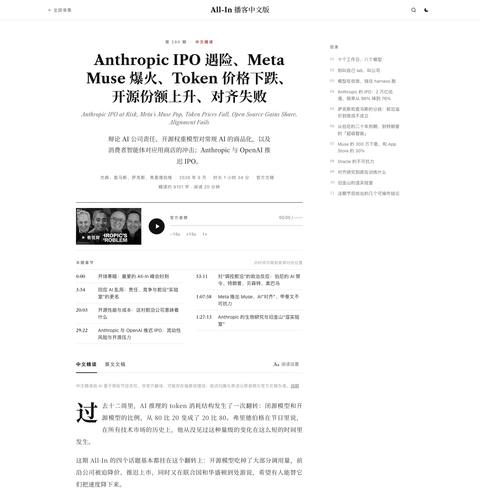

# allin-podcast-cn · All-In 播客中文版

**中文** | [English](#english)


> 把 [All-In Podcast](https://allin.com/) 全部单集（周播、嘉宾访谈、峰会对谈）变成**可以读、可以搜、可以追**的中文站：每期一个独立页面，官方音频与 YouTube 视频、带说话人的官方英文文稿、中文章节，以及按话题组织、观点归属到人的 AI 中文精读。纯静态，一条命令全量构建。
>
> A Chinese companion to the All-In Podcast: every episode on its own page with official audio & video, speaker-labelled transcripts, translated chapters, and AI-written Chinese deep-reads organized by topic — a static site built by one Python script.

[**在线阅读 →**](https://allin.qiaomu.ai/) · [单集目录](https://allin.qiaomu.ai/archive/) · [RSS 全文订阅](https://allin.qiaomu.ai/feed.xml) · [免责声明](https://allin.qiaomu.ai/disclaimer/)
[](LICENSE)
[](https://allin.qiaomu.ai/)

姊妹项目：[lexfridman-cn](https://github.com/joeseesun/lexfridman-cn)（[lex.qiaomu.ai](https://lex.qiaomu.ai/)），本仓库直接复用它的版式、阅读器与构建管线。

## 这是什么

All-In 是查马斯·帕里哈皮蒂亚、杰森·卡拉卡尼斯、大卫·萨克斯、大卫·弗里德伯格四位投资人的每周圆桌，一期一个半小时，聊科技、资本市场与美国政治，四个人经常意见相左。这个项目做了三件事：

1. **每期一页**：官方音频播放器（倍速记忆、断点续听）、视频点击加载、中英双语标题、中文章节时间轴（点时间跳播）、英文文稿时间戳跳播；
2. **中文精读**：AI 基于完整文稿改写的长文，按话题而不是时间顺序展开，每个论点和数字都标明是谁说的，分歧并陈、不替任何一方下结论；
3. **找得到**：全文搜索（`/` 唤起，话题、公司、嘉宾、期号都能搜）、周播 / 访谈与峰会筛选、按年份的单集目录、明暗与护眼主题。

非官方粉丝项目。本站不托管任何音频或视频文件，全部直链官方源，详见[免责声明](https://allin.qiaomu.ai/disclaimer/)。

## 核心能力

| 能力 | 你得到什么 |
|---|---|
| 全部单集 | RSS（libsyn）+ 官网后台 + YouTube 三路合并：周播按期号、嘉宾访谈与峰会单列，每期独立 URL（周播为 `/ep/e293/`） |
| 英文文稿 | 官网官方 Transcript（说话人按官网分轨时长还原成真名）> YouTube 字幕 > 本地 mlx-whisper 转写；来源在每页标明 |
| 中文精读 | 乔木风格提示词 + 禁用句式校验 + 带反馈重试；Magpie 订阅路由按质量动态轮换 |
| 中文章节 | 官方 show notes 的时间轴翻成中文，点时间跳到音频对应位置 |
| 阅读体验 | 纽约客式版面：首字下沉、杂志摘句、中文着重号、目录侧栏、阅读设置（6 种字体、字号、行距、版心宽度）、浅色 / 护眼 / 深色 |
| GEO / SEO | 首页预渲染、JSON-LD（PodcastEpisode / Article / Organization / ItemList）、每篇精读的 Markdown 版、llms.txt、sitemap、对 AI 爬虫开放的 robots |
| PWA | Service Worker 离线阅读、可安装、图标全家桶、每期 1200×630 分享卡片（按人脸位置裁切） |

## 详情页一览



## 快速开始

构建只用 Python 标准库（分享卡片需要 Pillow，没装会自动跳过）：

```bash
git clone https://github.com/joeseesun/allin-podcast-cn.git
cd allin-podcast-cn
python3 tools/build.py
python3 -m http.server 8123 -d site
```

元数据（`tools/allin-master.json`、`translations.json`、`transcript_sources.json`）与精读全文（`site/zh/`）已入库。受版权保护的英文文稿不入库，页面上的英文文稿区需要先跑下面的文稿管线。

<details>
<summary><strong>完整管线：追新、文稿、精读批产、部署（macOS）</strong></summary>

| 脚本 | 作用 |
|---|---|
| `tools/fetch_meta.py` | RSS + 官网 API（app.podcastai.com）+ YouTube 频道合并为 `allin-master.json`；期号、标题相似度、时长三重匹配，已发布的 slug 不变 |
| `tools/fetch_transcripts.py` | 官方 Transcript → YouTube 字幕 → 下载音频用 `mlx_whisper` 转写，断点续跑 |
| `tools/translate_titles.py` / `translate_chapters.py` | 中文标题、卡片短标题、一句话简介、中文章节 |
| `tools/gen_zh.py` | 中文精读批产；`--watch` 持续扫新文稿，每 30 篇自动 build + rsync |
| `tools/sync_new.py` | 日常追新：串起以上全部；官网补发官方文稿时自动替换 ASR 版并重写精读 |
| `tools/brand.py` / `og_faces.py` | 图标与分享卡片；人脸定位需要 `opencv-python-headless<5` |

模型通过乔木 Magpie 网关调用，API key 存在 macOS Keychain（服务 `qiaomu-llm`，账户 `magpie`），不进仓库。精读轮换（2026-10-19 用 E292 实测选定）：`workbuddy/deepseek-v4.1-flash` → `opencode-go/deepseek-v4.1-flash` → `workbuddy/glm-5.3` → `workbuddy/kimi-k3-1` → `trae-cn/deepseek-v4.1-flash`，按成功率与违规率自动升降位。

</details>

## 致谢

节目内容版权归 All-In 及嘉宾所有。中文精读由 AI 改写，非官方翻译，不构成投资建议。

作者：[向阳乔木](https://x.com/vista8) · 公众号「向阳乔木推荐看」

---

<a id="english"></a>

## English

**allin-podcast-cn** is an unofficial Chinese companion site for the [All-In Podcast](https://allin.com/), live at [allin.qiaomu.ai](https://allin.qiaomu.ai/).

- Every episode (weekly shows, interviews, summit talks) gets its own static page with official audio, the YouTube video, translated chapters and the English transcript.
- Transcripts come from the official allin.com transcripts first (speaker labels recovered by matching diarized talk time to the speaker list), then YouTube captions, then local Whisper transcription. The source is shown on each page; transcripts are not committed to this repo.
- Chinese deep-reads are written by LLMs through the Magpie gateway with a style prompt, a banned-phrase validator and feedback retries, organized by topic with every claim attributed to the person who made it.
- Built by `python3 tools/build.py` into `site/`: prerendered home page, JSON-LD, sitemap, `llms.txt`, Markdown copies of every article, RSS, a service worker for offline reading and per-episode share cards.

MIT licensed. Not affiliated with All-In or its hosts.
